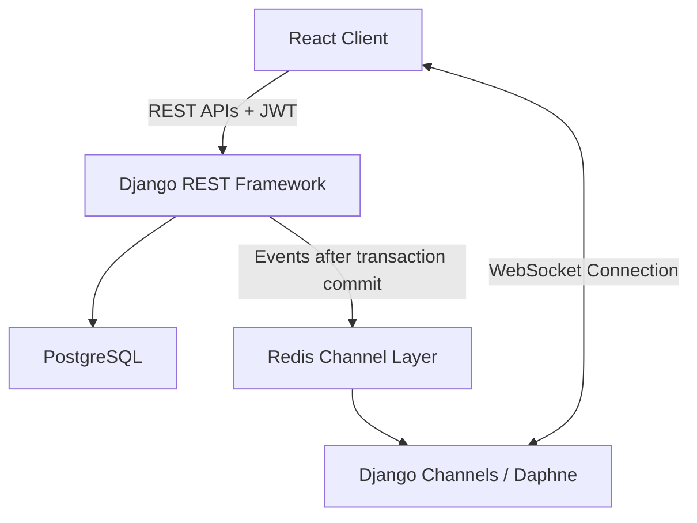

# Project Management System

**Plan work. Collaborate in real time. Track progress.**

This is a full-stack project management application for student teams and small workgroups. It brings workspace management, task tracking, Agile sprint planning, time logging and progress reporting into one application, with role-based access and real-time collaboration.

Developed by **Team 14** for **Software Engineering (UE24CS341A), PES University**.

---

## Table of Contents

- [Overview](#overview)
- [Features](#features)
- [Technology Stack](#technology-stack)
- [System Architecture](#system-architecture)
- [Getting Started](#getting-started)
- [Local Development](#local-development)
- [Environment Configuration](#environment-configuration)
- [Application Workflow](#application-workflow)
- [API Overview](#api-overview)
- [Testing and Quality Assurance](#testing-and-quality-assurance)
- [Project Structure](#project-structure)
- [Documentation](#documentation)
- [Troubleshooting](#troubleshooting)
- [Scope and Limitations](#scope-and-limitations)
- [Team](#team)
- [Contributing](#contributing)


## Overview

Managing project work across spreadsheets, messages and separate tools makes it difficult to track ownership, priorities and progress.

This project provides a shared environment where teams can:

- Organize members and projects within workspaces.
- Assign tasks and track their progress on a Kanban board.
- Plan sprints using backlog items and story-point estimates.
- Record time spent on tasks.
- Collaborate through live updates, comments and notifications.
- Review sprint performance and project workload.

The application connects planning, execution and reporting through a shared data model.

## Features

### Authentication and Workspace Management

- User registration and login with JWT authentication.
- Workspace creation and membership management.
- Invitation-based collaboration.
- Owner, Admin, Member and Viewer roles.
- Backend permission enforcement and workspace access checks.
- Security event logging with sensitive credentials redacted.

### Project and Task Management

- Project and task creation, viewing, editing and deletion, subject to permissions.
- Task assignment, priorities and due dates.
- Subtask management.
- Kanban columns: **Backlog**, **To Do**, **In Progress** and **Done**.
- Drag-and-drop task status changes.
- Task dependencies with cycle detection.
- Prevention of task completion while prerequisites remain unfinished.

### Agile Sprint Planning

- Product backlog management using the existing task model.
- Optional story-point estimates.
- Sprint creation with start and end dates.
- Assignment of eligible backlog items to planned sprints.
- Return of eligible, unstarted sprint items to the backlog.
- Sprint lifecycle: **Planned → Active → Completed**.
- Validation preventing empty sprints from starting.

### Time Tracking

- Positive whole-minute time entries with optional notes.
- Task-specific history and accumulated time.
- Time logging restricted to the task assignee or workspace Owner.
- Read-only access for Viewers.
- Server-controlled author, task association and timestamp.
- Preservation of historical authorship after task reassignment.

### Real-Time Collaboration

- Live task-board updates through WebSockets.
- Task comments and member mentions.
- Project activity feed.
- In-app notifications and read/unread tracking.
- Reconnection handling and data refresh after connection recovery.

### Reporting and Analytics

- Daily sprint burndown observations.
- Completed-sprint velocity and average velocity.
- Frozen reporting values for completed sprints.
- Workload distribution and overdue-task analytics.
- Chart refresh controls and periodic updates.

## Technology Stack

| Layer | Technologies | Purpose |
|---|---|---|
| Frontend | React 18, Vite | User interface and frontend builds |
| Charts | Recharts | Burndown and velocity visualization |
| Backend | Django, Django REST Framework | Models, APIs, validation and permissions |
| Authentication | SimpleJWT | Access and refresh tokens |
| Database | PostgreSQL 16 | Persistent relational data |
| Real-time communication | Django Channels, Daphne | WebSocket handling and ASGI serving |
| Channel layer | Redis 7 | Distribution of real-time events |
| Containerization | Docker Compose | Local service orchestration |
| Backend testing | Django test runner, DRF test utilities | Logic, API and integration testing |
| Frontend testing | Jest, React Testing Library, JSDOM | Component and interaction testing |
| Coverage | coverage.py, Jest coverage | Code and decision-path measurement |
| Static analysis | Ruff | Python code analysis |
| Version control | Git, GitHub | Collaboration and change tracking |

## System Architecture

React communicates with the backend through REST APIs for standard operations and WebSockets for live updates.

PostgreSQL stores application data. Redis supports event distribution between backend processes and connected clients.



The backend is organized into four main functional modules:

| Module | Responsibility |
|---|---|
| `accounts` | Authentication, workspaces, roles and security logging |
| `projects` | Projects, tasks, dependencies and analytics |
| `sprints` | Backlog, sprint lifecycle, time logging and reporting |
| `collaboration` | Comments, activity, notifications and WebSockets |

## Getting Started

### Prerequisites

- Git
- Docker Engine with Docker Compose, or Docker Desktop with Linux containers enabled
- Available local ports: `5173`, `8000`, `5433` and `6379`

### 1. Clone the Repository

```bash
git clone https://github.com/Sameekshakumar/Team14-Project-Management-System.git
cd Team14-Project-Management-System
```

### 2. Create the Environment File

**Windows PowerShell:**

```powershell
Copy-Item .env.example .env
```

**macOS / Linux:**

```bash
cp .env.example .env
```

Update `DJANGO_SECRET_KEY` and the development database password in `.env` before the first startup.

The supplied example values are local-development placeholders. Do not commit credentials or your `.env` file.

### 3. Build and Start the Application

```bash
docker compose up --build -d
docker compose ps
```

Inspect backend startup logs:

```bash
docker compose logs -f backend
```

The backend applies database migrations before starting Daphne.

Press `Ctrl+C` to leave log streaming. Detached services continue running.

### 4. Open the Application

| Service | Address |
|---|---|
| Frontend | http://localhost:5173 |
| Backend API origin | http://127.0.0.1:8000 |
| PostgreSQL from the host | `127.0.0.1:5433` |
| Redis from the host | `127.0.0.1:6379` |

Register through the application to create your first account.

The backend is an API service; its root URL does not need to display a homepage.

### Stop and Restart

```bash
docker compose stop
docker compose start
```

To remove containers and the Compose network while retaining named data volumes:

```bash
docker compose down
```

> Adding `--volumes` removes stored development data. Use it only when an intentional reset is required.

## Local Development

This option runs the backend and frontend on the host while PostgreSQL and Redis run in Docker.

Use **Python 3.12** and **Node.js 20** to align with the repository’s container images.

### 1. Configure Host Connections

After creating the root `.env`, set:

```dotenv
POSTGRES_HOST=127.0.0.1
POSTGRES_PORT=5433
CHANNEL_LAYER_BACKEND=redis
CHANNEL_REDIS_URL=redis://127.0.0.1:6379/0
```

> The example file uses PostgreSQL port `5432`. Host processes connecting to the Compose database must use `5433`. The backend container uses `db:5432` automatically.

### 2. Start PostgreSQL and Redis

From the repository root:

```bash
docker compose up -d db redis
```

If the full containerized application is already running, stop its backend and frontend before starting host processes on the same ports:

```bash
docker compose stop backend frontend
```

### 3. Set Up the Backend

```bash
cd backend
python -m venv .venv
```

Activate the virtual environment.

**Windows PowerShell:**

```powershell
.\.venv\Scripts\Activate.ps1
```

**macOS / Linux:**

```bash
source .venv/bin/activate
```

Install dependencies and start the backend:

```bash
python -m pip install -r requirements.txt
python manage.py migrate
python manage.py check
daphne -b 127.0.0.1 -p 8000 config.asgi:application
```

Daphne serves the complete ASGI application, including WebSockets.

### 4. Start the Frontend

In another terminal, from the repository root:

```bash
cd frontend
npm ci
npm run dev -- --port 5173 --strictPort
```

The API client defaults to the local backend. To override the origin, copy `frontend/.env.example` to `frontend/.env` and update `VITE_API_BASE_URL`.

Restart Vite after changing frontend environment values.

## Environment Configuration

Django loads the root `.env` file. Docker Compose also reads this file for service configuration.

| Variable | Purpose |
|---|---|
| `DJANGO_SECRET_KEY` | Django application secret |
| `DJANGO_DEBUG` | Enables development debug mode |
| `DJANGO_ALLOWED_HOSTS` | Comma-separated allowed backend hosts |
| `POSTGRES_DB` | Database name |
| `POSTGRES_USER` | Database user |
| `POSTGRES_PASSWORD` | Database password |
| `POSTGRES_HOST` | Database hostname |
| `POSTGRES_PORT` | Database port |
| `CHANNEL_LAYER_BACKEND` | `redis` for the complete stack; `memory` for isolated single-process use |
| `CHANNEL_REDIS_URL` | Redis connection URL |
| `CHANNEL_CAPACITY` | Channel capacity; default `1000` |
| `CHANNEL_MESSAGE_EXPIRY` | Message expiry in seconds; default `60` |
| `WS_MAX_CONNECTIONS_PER_PROJECT` | Configured project connection limit; default `100` |
| `WS_MAX_CONNECTIONS_PER_USER` | Configured user connection limit; default `50` |
| `WS_CONNECTION_LEASE_SECONDS` | Redis connection-lease lifetime; default `90` |
| `VITE_API_BASE_URL` | Browser-facing backend origin |

An in-memory channel layer does not distribute events across multiple backend processes. Configured connection limits are not measured load-test results.

## Application Workflow

1. Register and sign in.
2. Create a workspace and invite teammates.
3. Assign workspace roles.
4. Create a project and add tasks.
5. Set assignees, estimates, due dates and dependencies.
6. Select backlog items for a sprint.
7. Start the sprint and update task progress.
8. Log time and collaborate through comments and mentions.
9. Review burndown and project analytics.
10. Complete the sprint and inspect velocity.

For a real-time demonstration, open the same project in separate browser profiles or different browsers using two member accounts.

### Reporting Rules

- Burndown records daily latest-state observations.
- Multiple changes on one date update that date’s observation.
- Historical observations are not fabricated.
- Blank estimates contribute zero to point totals and are counted separately as unestimated work.
- Completed-sprint reporting values are frozen.
- Unfinished tasks remain attached to completed sprints.
- Velocity includes completed sprints only.
- Charts refresh periodically, on window focus and through **Refresh charts**.

## API Overview

Protected REST endpoints use:

```http
Authorization: Bearer <access_token>
```

| Area | Representative Endpoint |
|---|---|
| Registration | `/api/auth/register/` |
| Login | `/api/auth/login/` |
| Token refresh | `/api/auth/token/refresh/` |
| Current user | `/api/auth/me/` |
| Workspaces | `/api/auth/workspaces/` |
| Projects | `/api/workspaces/{workspace_id}/projects/` |
| Tasks | `/api/projects/{project_id}/tasks/` |
| Task details | `/api/tasks/{task_id}/` |
| Dependencies | `/api/tasks/{task_id}/dependencies/` |
| Backlog | `/api/v1/projects/{project_id}/backlog-items/` |
| Sprint creation | `/api/v1/sprints/` |
| Project sprints | `/api/v1/projects/{project_id}/sprints/` |
| Start sprint | `/api/v1/sprints/{sprint_id}/start/` |
| Complete sprint | `/api/v1/sprints/{sprint_id}/complete/` |
| Time entries | `/api/v1/tasks/{task_id}/time-entries/` |
| Burndown | `/api/v1/sprints/{sprint_id}/burndown/` |
| Velocity | `/api/v1/projects/{project_id}/velocity/` |
| Comments | `/api/tasks/{task_id}/comments/` |
| Activity | `/api/projects/{project_id}/activity/` |
| Notifications | `/api/notifications/` |
| Analytics | `/api/projects/{project_id}/analytics/` |

### WebSocket Routes

```text
/ws/projects/{project_id}/board/
/ws/notifications/
```

The client supplies `t14` and `bearer.<access-token>` as WebSocket subprotocols. Project connections require workspace membership.

See the implementation documents for request formats, permissions and endpoint-specific behavior.

## Testing and Quality Assurance

Testing covers backend logic, API workflows, permissions, frontend components, reporting and real-time interactions.

### Testing Approach

| Type | Examples |
|---|---|
| Unit testing | Validation and reporting calculations |
| API/integration testing | Authentication, task operations, sprint workflows and saved time totals |
| Frontend component testing | Forms, displayed data, error handling and refresh behavior |
| Security testing | Invalid tokens, unauthorized writes, workspace isolation and log redaction |
| Negative and boundary testing | Invalid dates, zero/negative minutes and estimate edge cases |
| Regression testing | Re-execution of existing suites after changes |
| Migration testing | Data preservation during reporting schema upgrades |
| Static analysis | Ruff code analysis |

### Backend Tests

From `backend/`, with the virtual environment active:

```bash
python manage.py test --settings=config.test_settings
```

The isolated configuration uses:

- In-memory SQLite.
- An in-memory Django Channels layer.

For Docker:

```bash
docker compose exec backend python manage.py test --settings=config.test_settings
```

These tests do not replace PostgreSQL-specific concurrency checks or Redis-backed load testing.

### Frontend Tests and Build

From `frontend/`:

```bash
npm ci
npm test
npm run build
```

Tests use Jest, React Testing Library and JSDOM. API responses are mocked, and chart tests mock Recharts.

### Coverage Reports

From `backend/`:

```bash
python -m pip install coverage
python -m coverage run --branch --source=accounts,projects,sprints,collaboration,common manage.py test --settings=config.test_settings
python -m coverage report -m --omit="*/test*.py,*/migrations/*"
python -m coverage html --omit="*/test*.py,*/migrations/*"
```

Open `backend/htmlcov/index.html` to inspect the HTML report.

These commands focus the report on application code. Results may differ from archived measurements that included tests and migrations.

From `frontend/`:

```bash
npm test -- --coverage --watchAll=false
```

To explicitly include application files beyond those exercised by existing tests:

```bash
npm test -- --coverage --watchAll=false --collectCoverageFrom="src/**/*.{js,jsx}" --collectCoverageFrom="!src/**/*.test.jsx"
```

### System and Migration Checks

From `backend/`:

```bash
python manage.py check
python manage.py makemigrations --check --dry-run
```

To run tests using the normal PostgreSQL/Redis configuration:

```bash
python manage.py test
```

Use a dedicated development/test environment. Django creates a test database, and the configured database user needs permission to do so.

### Recorded Results

The archived run dated **14 November 2026** records:

| Check | Recorded Result |
|---|---|
| Backend automated tests | **260 passed** |
| Frontend automated tests | **29 passed across 4 suites** |
| Django system check | No issues identified |
| Migration consistency check | No changes detected |
| Frontend production build | Passed, with a bundle-size warning |
| Backend statement coverage | **96%** |
| Backend combined statement-and-branch coverage | **94%** |
| Frontend statement coverage | **92.38%** |
| Frontend line coverage | **95.33%** |
| Frontend branch coverage | **83.62%** |

**Coverage scope:**

- Archived backend measurements include test files and migrations.
- Archived frontend measurements cover `Planning.jsx`, `TimeLogs.jsx` and `SprintCharts.jsx`.
- These frontend percentages do not describe the entire application.
- Passing tests establish the results of the executed checks, not the absence of all defects.

Reports and raw execution logs are available in the [QA documentation branch](https://github.com/Sameekshakumar/Team14-Project-Management-System/tree/qa/testing-and-reports/docs).

### Load Testing

The repository includes:

- `backend/tests/load/load_websockets.py`
- `backend/tests/load/requirements.txt`

The load client reports successful connections, delivered updates and delivery latency against a running application.

See [Real-Time Task Updates](04_IMPLEMENTATION/REALTIME_TASK_UPDATES.md) for setup. Run these checks with PostgreSQL, Redis, Daphne and dedicated test data.

## Project Structure

| Path | Contents |
|---|---|
| `backend/accounts/` | Authentication, workspaces, permissions and security logging |
| `backend/projects/` | Projects, tasks, dependencies and analytics |
| `backend/sprints/` | Backlog, sprints, time logging and reporting |
| `backend/collaboration/` | Comments, activity, notifications and WebSockets |
| `backend/common/` | Shared validation and sanitization |
| `backend/config/` | Settings, URLs and ASGI configuration |
| `backend/tests/load/` | WebSocket load-test client |
| `frontend/src/` | React components, API client, socket hook and tests |
| `01_SYNOPSIS/` | Project proposal |
| `02_REQUIREMENTS/` | Software Requirements Specification |
| `03_SRS_ARCHITECTURE_TEST/` | SRS, architecture and initial test plan |
| `04_IMPLEMENTATION/` | Feature implementation documentation |
| `docs/` on the QA branch | Testing reports and execution evidence |
| `docker-compose.yml` | Local application services |

## Documentation

- [Project Synopsis](01_SYNOPSIS/Team_14_Synopsis.pdf)
- [Software Requirements Specification](02_REQUIREMENTS/Team_14_SRS.pdf)
- [SRS, Architecture and Initial Test Plan](03_SRS_ARCHITECTURE_TEST/SRS_ARCHITECTURE_TEST.pdf)
- [Project and Task Management](04_IMPLEMENTATION/TASK_MODULE.md)
- [Backlog and Story Points](04_IMPLEMENTATION/ISSUE13_BACKLOG.md)
- [Sprint Planning](04_IMPLEMENTATION/ISSUE14_SPRINTS.md)
- [Time Logging](04_IMPLEMENTATION/ISSUE15_TIME_LOGGING.md)
- [Burndown and Velocity](04_IMPLEMENTATION/ISSUE16_SPRINT_CHARTS.md)
- [Collaboration and Analytics](04_IMPLEMENTATION/COLLABORATION_MODULE.md)
- [Real-Time Task Updates](04_IMPLEMENTATION/REALTIME_TASK_UPDATES.md)
- [Input Sanitization](04_IMPLEMENTATION/ISSUE21_INPUT_SANITIZATION.md)
- [Testing Reports and Evidence](https://github.com/Sameekshakumar/Team14-Project-Management-System/tree/qa/testing-and-reports/docs)

## Troubleshooting

| Problem | Suggested Check |
|---|---|
| Docker engine connection error | Start Docker Desktop/Engine and confirm Linux containers are available |
| Host backend cannot reach PostgreSQL | Use `127.0.0.1:5433`; verify database health and credentials |
| Frontend fetch/CORS error | Check backend availability, API origin and frontend port `5173` |
| Live updates do not appear | Verify Daphne, Redis, channel configuration and WebSocket authentication |
| Chart contains one actual point | A new sprint has limited observed history; observations accumulate over time |
| Permission denied | Check workspace role, membership and task assignment |
| Port already in use | Stop duplicate host/container processes |
| Container runs old application code | Rebuild the affected image |
| Changed database password does not work | Existing PostgreSQL volumes retain initialized credentials; editing `.env` alone does not change them |

## Scope and Limitations

- The supplied Docker Compose setup is intended for local development and demonstrations.
- The frontend container runs Vite’s development server.
- Production hosting requires deployment-specific configuration, HTTPS/WSS, secure secrets, backups and operational monitoring.
- Time entries are append-only through the provided API.
- Unfinished sprint tasks do not automatically roll over to the backlog.
- A single-active-sprint limit per project is not enforced.
- Direct database edits do not reconstruct historical sprint observations.
- JWT refresh rotation is enabled; blacklisting after rotation is not enabled.
- Payroll/billing, enterprise SSO, native mobile applications, external calendar synchronization and offline operation are outside the documented scope.

## Team

| Member | Functional Ownership | Supporting Responsibility |
|---|---|---|
| **Samarth M H** | Authentication, workspaces and access control | API design and review |
| **Sameeksha Prasanna Kumar** | Projects, tasks, Kanban and dependencies | UI/UX design |
| **Sanjana Guttapally** | Backlog, sprint planning, time logging, burndown and velocity | Database schema design |
| **Sanapureddy Hemanth Kumar Reddy** | Real-time collaboration, notifications and analytics | Testing and CI coordination |

Integration, testing and final validation are shared responsibilities.

## Contributing

1. Create a focused branch from the current `main`.
2. Link changes to the relevant issue or requirement.
3. Add or update tests for changed behavior.
4. Run relevant tests, build checks and migration checks.
5. Update documentation.
6. Open a pull request describing the change and validation performed.

Preserve migration history and commit any required new migrations. Keep credentials, `.env` files and local generated artifacts out of version control.

Report reproducible problems through [GitHub Issues](https://github.com/Sameekshakumar/Team14-Project-Management-System/issues).

